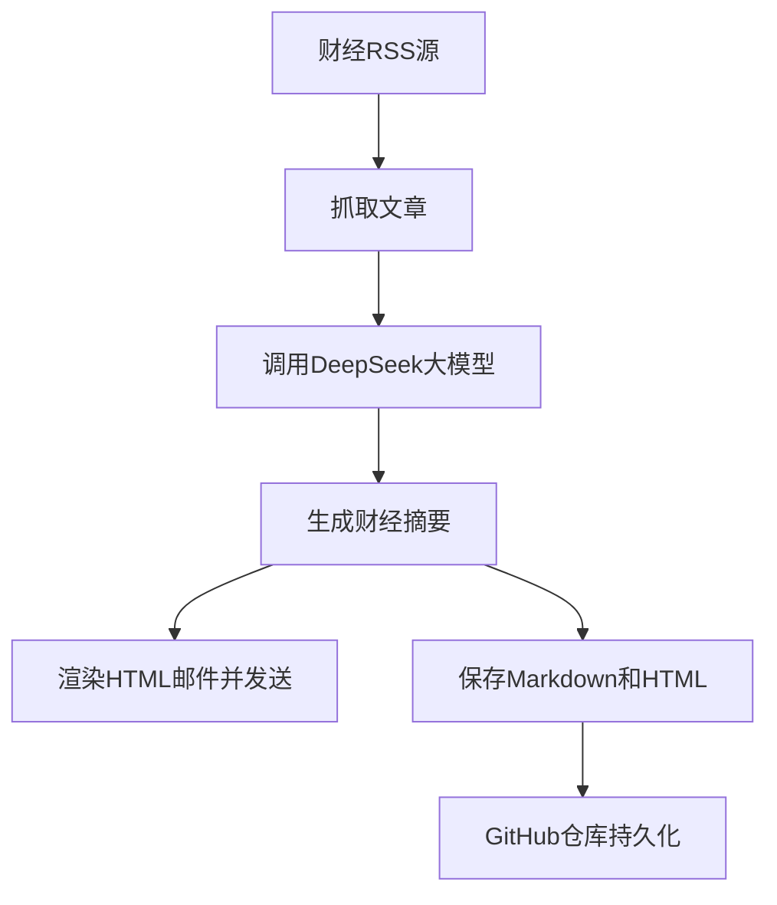

# 📈 FinNewsCollectionBot · 每日财经速递

**为专业投资者打造的智能财经资讯助手**

[](https://github.com/sgrsun3/FinNewsCollectionBot/actions/workflows/rss-bot.yml)


---
## 🧧 支持作者 · 让项目持续进化！

如果本项目对你有帮助，欢迎打赏支持，资助我多喝几杯咖啡 ☕，跑更多模型 💻～

<div align="center">
  
</div>

- 💬 微信号：`ArkhamKni9ht`
- 🙌 感谢每一位 Star、Fork 和支持者！

> ✨ 金融爸爸一块钱我不嫌少，一百块我也不嫌多 😊
---

## 🎯 项目简介

FinNewsCollectionBot 是一款为券商分析师、基金经理、研究员等专业投资人量身打造的**财经资讯智能摘要助手**。

它自动聚合主流财经媒体的 RSS 信息源，并调用 **DeepSeek 大语言模型**，每天两次推送核心财经摘要，帮助你快速掌握全球市场动态、产业趋势与政策走向。

---

## 🚀 核心功能

- ⏰ **每日两次自动摘要推送**  
  通过 cron-job.org 在北京时间每天 09:00、17:00 触发 GitHub Actions，生成分析报告

- 🌐 **多源财经 RSS 聚合**  
  支持华尔街见闻、36氪、东方财富、华尔街日报、BBC，以及美联储、欧洲央行的官方发布

- 📄 **A 股公司公告**
  从巨潮资讯获取业绩预告、业绩快报、定期报告和回购公告，提取 PDF 正文参与分析

- 📅 **发布时间筛选与发送记录**
  读取最近 24 小时的文章，过滤已经发送的链接，邮件发送成功后保存记录

- 🧠 **大模型深度分析**  
  使用 DeepSeek 大语言模型自动提炼财经新闻的核心内容与趋势判断

- 📧 **HTML 邮件推送**
  通过 SMTP 将完整报告作为 HTML 邮件正文发送，无需打开第三方详情页

- 🗂️ **双格式持久化**
  每次运行同时保存 Markdown 和 HTML，并由 GitHub Actions 自动提交到仓库

---

## 🧑‍💻 技术栈

- Python
- feedparser + newspaper3k
- Markdown + HTML 邮件
- DeepSeek 大语言模型 API
- GitHub Actions 执行任务，cron-job.org 定时触发

---

## 🔧 快速开始（GitHub Actions）

1. Fork 本项目后，打开 `Settings → Secrets and variables → Actions`。
2. 在 `Repository secrets` 中添加以下必填变量：

   | Secret | 说明 |
   | --- | --- |
   | `OPENAI_API_KEY` | DeepSeek API Key |
   | `SMTP_HOST` | SMTP 服务器，如 `smtp.qq.com` |
   | `SMTP_USERNAME` | 发件邮箱账号 |
   | `SMTP_PASSWORD` | 邮箱授权码或应用专用密码，不是普通登录密码 |
   | `MAIL_TO` | 收件邮箱；多个地址用英文逗号、分号或换行分隔 |

3. 需要时可添加以下可选变量：

   | Secret | 默认值 | 说明 |
   | --- | --- | --- |
   | `SMTP_PORT` | `465` | SMTP 端口 |
   | `SMTP_SECURITY` | `ssl` | 支持 `ssl` 或 `starttls` |
   | `MAIL_FROM` | `SMTP_USERNAME` | 邮件的发件人地址 |

4. 打开 `Settings → Actions → General → Workflow permissions`，确保允许 Actions 写入仓库。
5. 进入 `Actions → RSS 财经新闻邮件推送 → Run workflow` 手动测试一次。

常见邮箱配置：

| 邮箱 | `SMTP_HOST` | `SMTP_PORT` | `SMTP_SECURITY` |
| --- | --- | --- | --- |
| QQ 邮箱 | `smtp.qq.com` | `465` | `ssl` |
| 163 邮箱 | `smtp.163.com` | `465` | `ssl` |
| Gmail | `smtp.gmail.com` | `465` | `ssl` |
| Outlook.com | `smtp-mail.outlook.com` | `587` | `starttls` |
| Microsoft 365 | `smtp.office365.com` | `587` | `starttls` |

例如，向三个邮箱发送同一封报告时，将 `MAIL_TO` 设置为：

```text
alice@example.com,bob@example.com,team@example.com
```

也支持用英文分号或换行分隔。QQ 和 163 邮箱需要在邮箱设置中开启 SMTP 并生成授权码；Gmail 需要应用专用密码。请勿将密钥或授权码直接写入代码。

### 配置每天两次自动运行

工作流通过 `workflow_dispatch` 接受手动操作和外部 API 请求。完成以下配置后，由 cron-job.org 在北京时间每天 09:00 和 17:00 触发任务。

1. 在 GitHub 的 `Settings → Developer settings → Personal access tokens → Fine-grained tokens` 创建访问令牌。仅选择部署本项目的仓库，授予 `Actions: Read and write` 权限。记录有效期，并在到期前更新 cron-job.org 中的令牌。
2. 注册并登录 cron-job.org，创建定时任务，时区选择 `Asia/Shanghai`，运行时间选择每天 09:00 和 17:00。使用自定义 cron 表达式时填写 `0 9,17 * * *`。
3. 请求方式选择 `POST`。本仓库的请求地址为：

   ```text
   https://api.github.com/repos/mfy78/FinNewsCollectionBot/actions/workflows/rss-bot.yml/dispatches
   ```

   部署到其他仓库时，将地址中的 `mfy78/FinNewsCollectionBot` 替换为自己的仓库路径。

4. 配置以下请求头，将 `<GITHUB_TOKEN>` 替换为创建的访问令牌：

   ```text
   Authorization: Bearer <GITHUB_TOKEN>
   Accept: application/vnd.github+json
   Content-Type: application/json
   ```

5. 请求正文填写：

   ```json
   {"ref":"main"}
   ```

   如果仓库默认分支使用其他名称，将 `main` 替换为实际分支名称。

6. 开启 cron-job.org 的请求失败、失败恢复和任务自动停用通知。在 GitHub 个人设置的 `Notifications → System → Actions` 中开启工作流失败邮件通知。
7. 使用 cron-job.org 的测试功能发送一次请求，确认 GitHub Actions 出现 `workflow_dispatch` 运行记录、所有步骤执行成功，并确认收件邮箱收到报告。保存任务后，核查下次执行时间符合北京时间 09:00 和 17:00。

cron-job.org 的请求成功表示 GitHub 接受了触发请求，报告生成和邮件发送结果需要查看对应的 GitHub Actions 运行记录。两处通知分别用于发现触发失败和工作流执行失败。服务故障和访问令牌到期需要及时处理。

访问令牌只填写在 cron-job.org 的请求头设置中。DeepSeek API Key 和 SMTP 授权码继续保存在 GitHub Repository secrets 中。

配置参考：[GitHub 工作流触发 API](https://docs.github.com/en/rest/actions/workflows#create-a-workflow-dispatch-event)、[cron-job.org 使用说明](https://cron-job.org/en/faq/)。

### 数据来源与筛选规则

| 来源 | 获取内容 | 默认状态 |
| --- | --- | --- |
| 美联储货币政策 RSS | 货币政策公告、会议相关发布 | 启用 |
| 美联储官员讲话 RSS | 官员讲话原文 | 启用 |
| 欧洲央行 RSS | 新闻发布、讲话、采访与记者会文字 | 启用 |
| 巨潮资讯公开公告查询 | 业绩预告、业绩快报、年度、半年度、季度报告、回购公告 | 启用 |
| BLS RSS | CPI、PPI、就业报告、职位空缺 | 通过 `ENABLE_BLS_RSS` 启用 |

BLS 需要运行网络能够正常访问其官方 RSS。在仓库的 `Settings → Secrets and variables → Actions → Variables` 中设置 `ENABLE_BLS_RSS=true` 即可启用；默认关闭。官方来源请求返回 HTTP 错误或无法解析时，工作流会报告失败。

所有文章按照发布时间筛选最近 24 小时的内容，每个来源最多选择最新的 5 篇。没有可解析发布时间、发布时间超出范围或者链接已经发送的文章会跳过。同一链接在多个来源出现时，仅处理一次。巨潮资讯从符合公告类别和日期的最新 100 条结果中筛选，PDF 正文最多提取 6000 个字符；它提供的公告时间有时仅精确到日期，筛选使用接口给出的时间。

发送记录保存在 `reports/sent_articles.json`，与报告一同由 GitHub Actions 提交到仓库。SMTP 发送成功后才更新记录；发送失败时保留原记录。没有新文章时，程序直接结束，无需调用 DeepSeek 或发送邮件。首次运行从当前 24 小时内开始记录，已有历史报告不会自动导入发送记录。

SMTP 发送、记录保存和 GitHub 提交依次进行。如果邮件发送后保存或提交失败，下次运行可能再次发送相同文章，需要处理对应的工作流错误。

来源说明：[美联储 RSS](https://www.federalreserve.gov/feeds/feeds.htm)、[BLS RSS](https://www.bls.gov/feed/)、[欧洲央行 RSS](https://www.ecb.europa.eu/home/html/rss.en.html)、[巨潮资讯](https://www.cninfo.com.cn/)。

### 本地验证

安装 `requirements.txt` 后，执行：

```bash
python -m unittest -v test_news_sources
```

测试覆盖日期筛选、链接去重、发送记录、公告字段处理、请求失败和邮件发送失败时的记录行为。GitHub Actions 在执行新闻任务前运行相同测试。

## 🗂️ 报告归档

每次成功生成摘要后，报告会保存为：

```text
reports/
└── 2026/
    └── 09/
        ├── 2026-09-02-090000.md
        └── 2026-09-02-090000.html
```

HTML 文件与邮件正文内容一致，Markdown 文件保留便于搜索和二次处理的原始格式。

> 注意：公开 fork 中的 `reports/` 文件任何人都能查看。GitHub 不支持将公开仓库的 fork 直接改为私有；如果报告不应公开，请将项目复制到独立的私有仓库。

---

## 💼 使用场景

- 券商/基金公司/研究所自动生成投资快报
- 金融从业者日常资讯监测
- 个人投资者快捷了解宏观政策/产业热点
- 财经内容运营/财经公众号 AI 辅助创作

---

## 📌 示例流程图



---

## 🛠️ 后续规划

- ✅ 增加更多 RSS 财经数据源
- ✅ 引入情绪分析与金融事件检测
- ⏳ 支持多语言财经摘要生成
- ⏳ 构建简洁前端页面用于非技术用户管理配置

---

## 🤝 欢迎参与

📬 欢迎 Star ⭐ / Fork 🍴 / PR 💡 本项目，一起共建更智能的财经决策工具。

你也可以通过 Issues 留言建议功能，或私信我交流使用体验～

---

© 2024 sgrsun3 | MIT License
